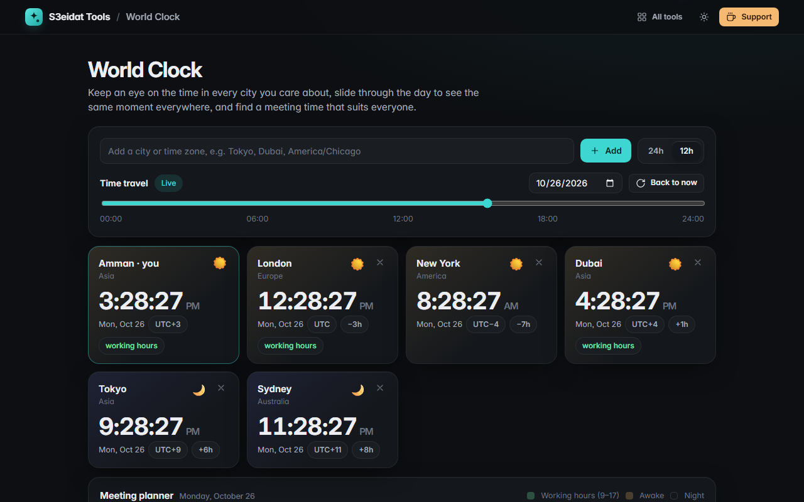

# World Clock

> Live clocks for any city, a time slider and a meeting planner. Free, private, and it runs entirely in your browser.

### ▶ [Open World Clock](https://s3eidat.github.io/world-clock/)



## Features

- **Add any city or time zone**: searches every IANA time zone your browser knows, plus common city names (Mecca, Delhi, San Francisco…)
- **Live clocks** with date, UTC offset, difference from your time, and a **day/night** indicator
- **Time travel slider**: drag through any day to see the same moment in every city
- **Meeting planner** grid: 24 hours side by side, working hours (9–17) in green, awake hours in amber, night in grey, and the hours where everyone is at work outlined
- 12h / 24h format; DST handled by the browser's own time-zone data
- Your cities are saved locally

## Privacy

Your list of cities is saved only in your browser (localStorage). There is no server, no account, no analytics.
The page ships with a strict Content-Security-Policy (`connect-src 'self'`), so the browser
itself blocks any attempt to send data anywhere.

## Run it yourself

It's plain HTML, CSS and JavaScript with no build step:

```bash
git clone https://github.com/s3eidat/world-clock
cd world-clock
python -m http.server 8000
```

Then open http://localhost:8000.

## Support

If this saved you time, **[buy me a coffee ☕](https://s3eidat.github.io/coffee/)**. It keeps every tool free.

---

Part of **[S3eidat Tools](https://s3eidat.github.io/)**: 100+ free, private tools that run in your browser. MIT licensed.
